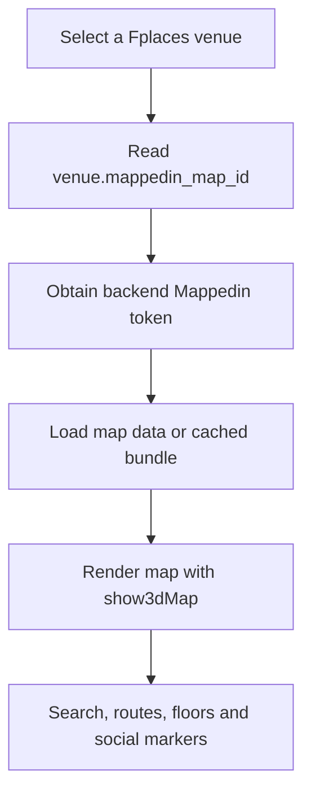

# Create an AI-assisted Mappedin map and use it in Fplaces

Verified against the local Fplaces working tree and official Mappedin documentation on **24 September 2026**. This guide describes the current PWA, including local changes that have not necessarily been deployed.

The workflow is: prepare a real floor plan → create and review the map in Mappedin Maker → make it available to the SDK → connect it to a Fplaces venue → test it in the PWA. Map creation happens in Maker; Fplaces already provides the map viewer and application features.

## 1. What you need

- A Mappedin account with access to the workspace that will own the map.
- A floor plan for each level, the building address, floor names, and a verified list of destinations.
- Access to the Fplaces backend configuration and venue records, or a backend teammate who can update them.
- This repository and Node.js/npm for local testing.
- A phone at the venue for checking positioning and AR after map browsing and routing work.

Maker accepts PNG, JPEG, WebP, PDF, DXF, and DWG floor plans. Open [Mappedin Maker](https://app.mappedin.com/editor/) to begin. See the [Maker guide](https://developer.mappedin.com/docs/maker) for supported inputs.

Creating a map and using your own map through the SDK have separate access requirements. The [SDK getting-started guide](https://developer.mappedin.com/web-sdk/getting-started) currently describes Pro/Solutions access for your own credentials. Confirm your workspace's SDK entitlement before integration; free map creation alone does not establish it. Current commercial options are on [Mappedin pricing](https://www.mappedin.com/pricing/).

## 2. Prepare a small first map

Start with one real floor and a few destinations: an entrance, reception, a room or shop, a restroom, and a staircase or lift if applicable. Expand after that floor works in Fplaces.

Use a clear plan with readable labels and visible openings. Mappedin recommends high-resolution, axis-aligned plans with black linework on white for better AI results. See [Mappedin's floor-plan preparation tips](https://www.mappedin.com/resources/blog/5-tips-and-tricks-for-making-your-best-indoor-map/).

Make a destination inventory before drawing. For example:

| Floor | Display name | Kind | Check on site |
|---|---|---|---|
| Ground | Main Entrance | Entrance | Actual public entry position |
| Ground | Reception | Service point | Walkable approach |
| Ground | Room G01 | Room | Correct door and room number |
| Ground | Accessible Restroom | Amenity | Access and label confirmed |
| Ground / Level 1 | Lift A | Floor connection | Floors served and actual access |

These are example labels, not details to invent for your building. Confirm actual geometry, doors, floor order, and access restrictions with someone who knows the venue.

## 3. Create the map with Maker's AI

Maker's screen labels can change. The steps below describe the workflow; follow the equivalent controls in your workspace.

1. Sign in and start a new map/building in the intended workspace.
2. Give it a recognizable venue name and enter the building address.
3. Upload the floor plans and assign the correct levels. Check that separate pages represent the intended floors.
4. Check placement against the real building: scale, rotation, address, and alignment between levels. To adjust placement, use the options menu's **Address and World Position** control. See the [Maker guide](https://developer.mappedin.com/docs/maker).
5. Use **Run AI Mapping** when available, or the AI mapping stage offered during creation. Review which floors will be processed. Current release notes describe an **Empty Floors** default for this operation. See [Maker release notes](https://developer.mappedin.com/docs/maker/release-notes).
6. Wait for the generated map, then compare it with the plan and the actual venue.

Mappedin's AI can detect walls, doors, windows, stairs, elevators, and labels from the uploaded plan. Treat the result as a draft to inspect. See [Mappedin's AI mapping overview](https://www.mappedin.com/resources/blog/maps-made-easy-setting-the-bar-for-ai-mapping/).

Recent Maker releases also describe AI georeferencing, floor alignment, and automatic publication at the end of the AI pipeline. **Check the resulting publication status immediately** and review the generated map before attaching it to a Fplaces venue used by visitors. See [Maker release notes](https://developer.mappedin.com/docs/maker/release-notes).

### Review the generated map

Use this as the Fplaces acceptance checklist for the map itself:

- Walls match the building; adjacent rooms have not been accidentally merged.
- Doors connect rooms to the appropriate corridors.
- Windows have not become doorways or walkable openings.
- Public walking areas connect continuously from entrance to destination.
- Stairs, lifts, and escalators connect the correct floors.
- Restricted spaces cannot become unintended public shortcuts.
- Floors line up vertically and have understandable names.
- Room numbers and place names match signs in the building.
- Routes reach the actual usable entrance to each destination.

For multi-floor work, review connections explicitly rather than relying on the appearance of a stair or lift symbol. Mappedin's [Maker tips](https://www.mappedin.com/resources/blog/mappedin-maker-tips-and-tricks) describe defining floor spans for connections and using enclosed spaces for them.

### Add useful, searchable locations

Give destinations meaningful names and attach their location records to the right geometry. The current PWA collects names from Maker `location-profile` records, Enterprise locations, and named spaces. It also uses Maker profile search tags when building search chips. See [search-service.ts](../mappedin-pwa/src/services/search-service.ts).

Prefer `Reception`, `Room G01`, and `North Entrance` over labels such as `Space 12`. Distinguish repeated names by floor or wing. If you later connect a location to a Fplaces section, preserve its ID when editing wherever possible.

## 4. Use an AI assistant for the supporting work

Maker's AI produces map geometry from a plan. A general AI assistant can help organize labels, identify ambiguous source material, and prepare test cases. It should flag missing facts for a person to check.

The following are suggested prompts, not built-in Maker commands. Supply the actual plan or inventory to the assistant.

**Extract a destination inventory:**

```text
Review this floor plan and list the visible destinations in a table:
floor, exact label, proposed display name, destination type, and uncertainty.
Preserve room numbers. Mark unreadable labels as unknown. Do not invent
dimensions, doors, access permissions, coordinates, or missing rooms.
```

**Clean up names:**

```text
Standardize this venue's destination names for indoor search. Keep official
names and room numbers. Identify duplicates that need a floor or wing suffix.
Suggest search aliases separately and flag anything requiring venue approval.
```

**Prepare a walkthrough:**

```text
Using this verified destination list, propose route tests for Fplaces:
entrance to reception, reception to a room, restroom access, and a journey
between floors. For each, list what a person must check on site. Separate
manual route planning from live positioning and AR verification. Mark
accessibility claims as unverified unless supported by the supplied facts.
```

Review the assistant's output before adding it to Maker. A generated floor-plan illustration is useful for a fictional demo, but cannot establish the geometry of a real venue.

## 5. Make the map available to Fplaces

In Maker's preview/share controls, verify the map is **Live** and that your reviewed edits have been published. The documented manual flow is **Preview → Share Maps → Draft to Live**. AI-created maps may already be published. See the [Maker guide](https://developer.mappedin.com/docs/maker) and [release notes](https://developer.mappedin.com/docs/maker/release-notes).

In **Developers**, select your map and copy its `mapId`. Generate an API key and secret for the workspace if needed. Store these on the Fplaces backend. Maker supports scoped keys; ensure the credentials permit reading the map. See [SDK setup](https://developer.mappedin.com/web-sdk/getting-started) and [key-scope release notes](https://developer.mappedin.com/docs/maker/release-notes).

Give your backend teammate:

| Item | Purpose |
|---|---|
| Fplaces venue ID | Identifies the venue record to update |
| Mappedin map ID | Value for the venue's `mappedin_map_id` |
| Workspace credentials, through your secret-management process | Allow the backend to obtain a Mappedin token |
| Floor names and actual Mappedin floor IDs | Support later positioning configuration |
| Location IDs and corresponding Fplaces sections | Connect social content to map locations |

## 6. Connect it to the PWA as it currently stands

### How map loading works

The app uses Vite, TypeScript, and Mappedin JS v6; [package.json](../mappedin-pwa/package.json) declares `@mappedin/mappedin-js` as `^6.27.0`.



The loading implementation is in [map-app.ts](../mappedin-pwa/src/services/map-app.ts). You do not need to add a second SDK viewer or paste Maker's iframe embed into the app.

### A. Update the backend venue

The PWA reads venue records through `/api/forum/venues/`. Set the intended record's `mappedin_map_id` to the new map ID. For example, these are the relevant fields from a venue response, with illustrative values:

```json
{
  "id": 42,
  "name": "Example Venue",
  "mappedin_map_id": "YOUR_PUBLISHED_MAPPEDIN_MAP_ID"
}
```

This is a response excerpt, **not a documented create/update request**. Use your backend's existing administration process. This checkout establishes the frontend read contract; it does not establish the backend's admin write endpoint or secret configuration names. See [venue entities](../mappedin-pwa/src/forum/domain/entities.ts) and [API datasource](../mappedin-pwa/src/forum/data/datasources/forum-remote-datasource.ts).

**Current fallback behavior:** `.env.example` advertises `VITE_MAPPEDIN_MAP_ID`, and `config.ts` reads it. `selectedVenueMapLoadRequest()` now passes that configured fallback into `venueMapLoadRequest()`, so changing `VITE_MAPPEDIN_MAP_ID` switches the default map used when the selected venue has no `mappedin_map_id`. Catalog venues should still set the backend venue's `mappedin_map_id` so each venue loads its own map. See [venue-map-source.ts](../mappedin-pwa/src/forum/domain/venue-map-source.ts) and [map-app.ts](../mappedin-pwa/src/services/map-app.ts).

### B. Ensure backend tokens can read the new map

The current frontend expects:

| Session | Endpoint | Mappedin token field |
|---|---|---|
| Guest | `POST /api/users/guest/` | `mappedin.token` in the guest session response |
| Signed-in user | `GET /api/maps/token/` | `token` or nested `mappedin.token`; the datasource also accepts a plain string |

These are Mappedin access tokens, separate from Fplaces login tokens. Both session paths must issue credentials that can read the new map. The selected venue's map ID takes priority over a map ID in the maps-token response. See [maps-service.ts](../mappedin-pwa/src/services/maps-service.ts) and [maps datasource](../mappedin-pwa/src/maps/data/datasources/maps-remote-datasource.ts).

For Maker maps, the documented server-side token exchange is `POST https://app.mappedin.com/api/v1/api-key/token` with the key and secret; the returned `access_token` is used by the SDK. See [bearer-token authentication](https://developer.mappedin.com/web-sdk/getting-started#authenticating-with-a-bearer-token).

Keep Mappedin API secrets on the backend. Do not put them in frontend `VITE_*` variables, source code, or shared diagnostic logs. The current PWA already uses the backend-token flow.

### C. Link Fplaces sections when needed

Map display and routing can be checked before social integration. To connect section-based activity to the correct map location, populate the backend section's `mappedin_location_id`.

Example response excerpt:

```json
{
  "id": 7,
  "venue": 42,
  "name": "Reception",
  "mappedin_location_id": "ACTUAL_MAPPEDIN_LOCATION_PROFILE_ID"
}
```

For Maker locations, the marker collector uses the location profile's ID. For a named space without a profile anchor, it can use the space ID. The join is by ID, not matching names or name slugs. See [location-anchors.ts](../mappedin-pwa/src/map/location-anchors.ts) and [section-locations.ts](../mappedin-pwa/src/forum/domain/section-locations.ts).

To obtain the IDs, a developer can inspect the loaded `MapData` with `getByType('location-profile')`, reading each record's `id` and `name`, and compare those records with `collectLocationAnchors(mapData)`. Use a debugger where `mapData` is available; this guide does not assume the app exposes it as a browser global. Preserve the mapping in your venue inventory. Recreating a location may require updating the backend association.

## 7. Run and verify Fplaces

From the repository root:

```bash
cd mappedin-pwa
npm ci
npm run dev
```

Review `.env.example` for available settings. If local environment files already exist, edit only the values needed; do not overwrite them. Leave `VITE_API_URL` unset for the default `/api` proxy unless you intentionally use another backend.

Open the URL Vite prints. The current [Vite configuration](../mappedin-pwa/vite.config.ts) includes `basicSsl()`, binds to the network, and uses port 5173 by default. For phone camera and location testing, use a trusted HTTPS deployment or correctly trusted development certificate.

Test in this order:

1. Enter the app as a guest and select the intended venue.
2. Confirm the map is your building, with correct floor names and geometry.
3. Search for at least three named destinations and check their map positions.
4. Set a start and destination manually. Confirm the route follows real doors and corridors.
5. Test a journey between floors if the map has multiple levels.
6. Repeat the map-loading check while signed in; the token endpoint is different.
7. If sections are configured, verify the map location opens the expected social content.
8. Test location and AR separately on a phone at the venue.

For a production build check:

```bash
npm run build
npm run preview
```

The build script also copies the sibling `ar-nav/` module into `public/ar/`. Follow the preview URL printed in the terminal. A successful build verifies compilation and bundling; it does not verify the new map's account permissions or physical accuracy.

## 8. What map creation does—and what still needs venue setup

| Capability | Current PWA behavior | Venue setup needed |
|---|---|---|
| Map display and floor selection | Loads the selected venue's map | Published map, venue ID association, working token |
| Search and route planning | Uses Mappedin data | Named destinations and valid walking connections |
| Social map content | Uses backend data and location anchors | Correct section/location IDs and backend connectivity |
| Live positioning | Has GPS, IndoorAtlas, and BLE providers | Actual provider setup, correct venue data, device support, on-site checks |
| AR / Live View | Uses the separate `ar-nav/` module | Valid route, camera permissions, suitable positioning and device testing |
| Offline map data | Best-effort cached bundles | Successful prior online load plus session/startup conditions |

**A correct map does not by itself provide room-level indoor positioning.** The current readiness code explicitly treats browser GPS as insufficient for that claim. See [positioning-readiness.ts](../mappedin-pwa/src/position/domain/positioning-readiness.ts).

For the current positioning implementation:

- IndoorAtlas needs a working SDK integration and the venue's floor mapping. The checked-in [IndoorAtlas floor map](../mappedin-pwa/src/position/config/indoor-atlas-floor-map.json) is empty. The provider falls back to GPS when setup fails or floor mapping is invalid.
- BLE needs supported browser/device capabilities and installed beacons whose identifiers, coordinates, and floor IDs match the venue. The checked-in [beacon matrix](../mappedin-pwa/src/position/config/beacon-venue-matrix.json) contains demo-map data.
- Provider selection is in [providerRegistry.ts](../mappedin-pwa/src/position/providerRegistry.ts). An environment override can force a provider; otherwise it checks for an IndoorAtlas key, then eligible BLE configuration, then GPS. Selecting a provider does not prove it initialized successfully.
- The viewer currently disables the outdoor world view in [venue-map-view.ts](../mappedin-pwa/src/map/domain/venue-map-view.ts). Validate indoor navigation first when considering a larger campus map.

The older PWA README describes continuous tracking as excluded; the current implementation has progressed beyond that description. Use the source files above and the [live-tracking release checklist](live-tracking-release-checks.md) for the current checks.

Offline loading also has limits. [map-offline-service.ts](../mappedin-pwa/src/services/map-offline-service.ts) tries the network first and caches binary map bundles in IndexedDB. However, `map-app.ts` resolves credentials before loading map data, so a cached map alone does not guarantee a fresh offline session can start. Test an actual offline reopen; do not promise fully offline login, social feeds, or first-time map loading.

## 9. Troubleshooting

| Symptom | First checks |
|---|---|
| Demo mall appears | Inspect the selected backend venue's `mappedin_map_id`; see the fallback behavior in step 6. |
| Map fails to load | Inspect the guest/maps-token response, then the Mappedin request. Check publication, map ID, credential access and SDK entitlement. |
| Guest works but signed-in user fails, or vice versa | Check both token-issuing paths and the account/workspace each uses. |
| New venue is missing | Verify it appears in `/api/forum/venues/`; creating a Maker map does not create a Fplaces venue record. |
| Search misses a room | Check its name/location profile, association with geometry, and publication of the edit. |
| No route or route crosses the wrong area | Inspect doors, walking connectivity, restrictions and floor connections in Maker. |
| Social activity attaches to the wrong place | Compare section `mappedin_location_id` with the actual anchor location ID, including profile-versus-space differences. |
| Blue dot is outside the building or on the wrong floor | Verify georeferencing, actual active provider, floor mapping, and real device measurements. |
| Changes appear stale | Confirm publication, reopen online, and check whether the app reports cached map loading. |
| Offline reopen fails | Check prior caching and credential/session startup; map caching does not bypass authentication. |
| Phone camera fails | Check HTTPS trust and browser camera permissions, then the AR integration. |

Use browser Network tools and the existing [logger.ts](../mappedin-pwa/src/utils/logger.ts) for diagnostics. Record status codes and sanitized errors rather than token values.

## 10. First-venue completion checklist

- [ ] AI-generated geometry has been checked against the real venue.
- [ ] Scale, orientation, floor order, names, doors and connections are correct.
- [ ] Reviewed map data is published and accessible through the workspace's SDK credentials.
- [ ] The backend venue returns the correct `mappedin_map_id`.
- [ ] Guest and signed-in sessions both load the map.
- [ ] Search and manual routes pass the walkthrough checks.
- [ ] Required social sections use verified Mappedin location IDs.
- [ ] Positioning and AR are recorded separately as tested or still awaiting venue setup.
- [ ] Offline behavior has been tested without assuming first-time offline access.
- [ ] Someone owns future floor-plan updates, publication and ID-mapping maintenance.
